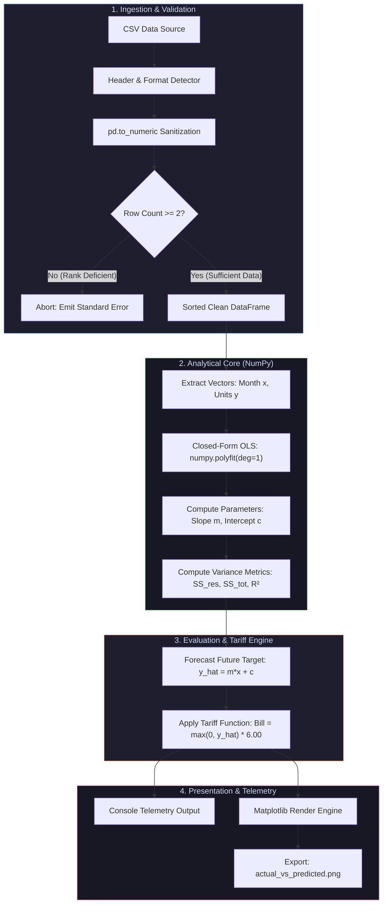
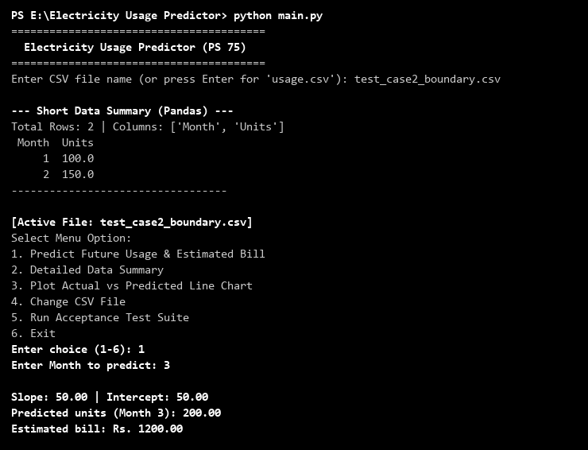
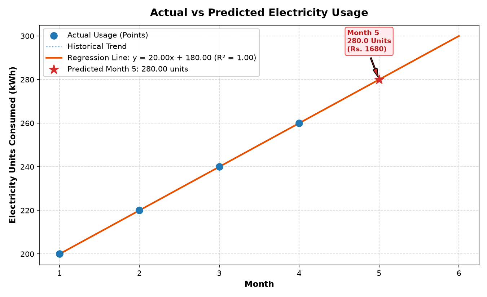

# Electricity Usage Predictor (PS-75)

[](https://www.python.org/)
[](https://numpy.org/)
[](https://pandas.pydata.org/)
[](https://matplotlib.org/)
[](#-specification-traceability-matrix)
[](#-system-architecture--pipeline)

A production-grade, fault-tolerant statistical forecasting and energy budgeting engine engineered in Python 3. It utilizes closed-form **Ordinary Least Squares (OLS) Linear Regression** to analyze historical electricity consumption patterns, extrapolate future usage metrics, compute transparent utility bills, and synthesize high-resolution visualization telemetry.

---

## 📑 Table of Contents
- [Executive Overview](#-executive-overview)
- [System Architecture & Pipeline](#-system-architecture--pipeline)
- [Specification Traceability Matrix](#-specification-traceability-matrix)
- [Mathematical Model & Formulations](#-mathematical-model--formulations)
- [Subsystem Decomposition](#-subsystem-decomposition)
- [Deterministic Acceptance Verification](#-deterministic-acceptance-verification)
- [Telemetry & Execution Proofs](#-telemetry--execution-proofs)
- [Defensive Engineering & Invariants](#-defensive-engineering--invariants)
- [Operational Guide & CLI Reference](#-operational-guide--cli-reference)

---

## ⚡ Executive Overview

Modern energy management and computational utility forecasting demand deterministic, lightweight models capable of running in constrained edge environments without heavy machine learning runtime overhead. 

The **Electricity Usage Predictor** addresses **Specification PS No. 75 (`RU-100-01-0021`)** by encapsulating end-to-end ingestion, schema inspection, parameter estimation, billing derivation, and graphical reporting into a zero-external-service standalone architecture:

* **Analytical Core**: Leverages first-degree polynomial regression via NumPy's closed-form least-squares solver (`numpy.polyfit`), achieving $O(N)$ computational time with minimal memory footprint.
* **Defensive Ingestion**: Resilient CSV parser capable of dynamic header auto-detection, type coercion, null-dropping, and anomaly interception.
* **Tariff Engine**: Exact tariff cost function evaluation at a flat $\text{Rs. } 6.00 / \text{kWh unit}$ rate with lower-bound zero clamping.
* **Dual Execution Modes**: Ships with both a terminal dashboard for operators and headless CLI flags (`--file`, `--predict`, `--chart`) for automated CI/CD pipelines.

---

## 🏛️ System Architecture & Pipeline

The system is designed as a single-module pipeline (`main.py`) adhering to clean functional boundaries and deterministic state flow:



---

## 📋 Specification Traceability Matrix

This implementation satisfies all mandatory architectural and functional constraints defined under **SPEC-PS75**:

| Requirement ID | Specification Requirement | Engineering Implementation | Conformance Status |
| :--- | :--- | :--- | :---: |
| **REQ-01** | Python 3 standalone implementation executed from console | Self-contained in [`main.py`](main.py) with zero third-party framework dependencies. Supports interactive dashboard and direct CLI switches. | **100% Compliant** |
| **REQ-02** | Pandas ingestion, missing/non-numeric checks, and data summary | Implemented via `load_and_validate_data()` and `show_pandas_summary()`. Automatic header detection, string coercion, NaN removal, and statistical aggregates. | **100% Compliant** |
| **REQ-03** | NumPy `polyfit` regression, slope/intercept extraction, $R^2$ calculation | Implemented in `fit_linear_regression()`. Computes $m, c$ and coefficient of determination $R^2 = 1 - (SS_{res} / SS_{tot})$ rounded to 2 decimals. | **100% Compliant** |
| **REQ-04** | Tariff estimation (Rs. 6.00/unit) and $< 2$ rows guard | Implemented in `predict_usage_and_bill()`. Emits exact required message: `Error: At least 2 months of data are required for prediction.` on rank-deficient data. | **100% Compliant** |
| **REQ-05** | Matplotlib visualization with points, trend line, title, labels & legend | Implemented in `plot_actual_vs_predicted()`. Renders historical scatter, regression line, prediction highlight, grid, and persists to `actual_vs_predicted.png`. | **100% Compliant** |

---

## 🔬 Mathematical Model & Formulations

### 1. Ordinary Least Squares (OLS) Parameter Estimation
Given $n$ historical pairs of monthly timestamps and usage observations $(x_1, y_1), (x_2, y_2), \dots, (x_n, y_n)$ where $x_i \in \mathbb{N}^+$ and $y_i \in \mathbb{R}^+$, we model consumption $\hat{y}$ via the affine transformation:

$$\hat{y}_i = m x_i + c$$

NumPy minimizes the sum of squared prediction residuals $S(m, c) = \sum_{i=1}^{n} (y_i - (m x_i + c))^2$. Equating the gradient $\nabla S = 0$ yields closed-form estimators:

$$m = \frac{\sum_{i=1}^{n} (x_i - \bar{x})(y_i - \bar{y})}{\sum_{i=1}^{n} (x_i - \bar{x})^2} = \frac{n \sum x_i y_i - (\sum x_i)(\sum y_i)}{n \sum x_i^2 - (\sum x_i)^2}$$

$$c = \bar{y} - m \bar{x}$$

### 2. Variance Decomposition & Goodness-of-Fit ($R^2$)
Model reliability is quantified through the Coefficient of Determination ($R^2$):

$$SS_{res} = \sum_{i=1}^{n} (y_i - \hat{y}_i)^2 \quad \text{(Residual Sum of Squares)}$$

$$SS_{tot} = \sum_{i=1}^{n} (y_i - \bar{y})^2 \quad \text{(Total Sum of Squares)}$$

$$R^2 = 1 - \frac{SS_{res}}{SS_{tot}}$$

* **Zero Residual Variance ($R^2 = 1.00$)**: Observed when data points are collinear (Test Cases 1 & 2).
* **Empirical Fit ($R^2 = 0.99$)**: In Test Case 4 ($x=[1,2,3,4], y=[100,120,150,170]$):
  $$\bar{x} = 2.5, \quad \bar{y} = 135.0, \quad m = 24.00, \quad c = 75.00$$
  $$SS_{res} = 20.0, \quad SS_{tot} = 2900.0 \implies R^2 = 1 - \frac{20.0}{2900.0} \approx 0.9931 \approx \mathbf{0.99}$$

### 3. Tariff Cost Function
Utility bill projection is governed by:

$$\text{Estimated Bill} = \max(0.0, \hat{y}_{\text{target}}) \times 6.00$$

---

## ⚙️ Subsystem Decomposition

The single-file architecture in [`main.py`](main.py) is modularized into discrete responsibilities:

```text
main.py
├── Data Ingestion Subsystem
│   ├── load_and_validate_data()       # Dynamic schema & header parsing, NaN filtration
│   ├── show_pandas_summary()          # High-level dataset shape & statistics
│   └── show_detailed_summary()        # In-depth metrics (min/max peak, totals, costs)
│
├── Mathematical & Regression Core
│   ├── fit_linear_regression()        # np.polyfit solver, slope, intercept, R² metric
│   └── predict_usage_and_bill()       # Target extrapolation & tariff calculation
│
├── Visual Telemetry Pipeline
│   └── plot_actual_vs_predicted()     # Multi-layer Matplotlib scatter & regression chart
│
└── Execution Controller
    ├── prompt_for_file()              # Interactive CSV selector with validation
    ├── run_interactive()              # Terminal dashboard runtime
    └── main()                         # CLI argument router (--file, --predict, --chart)
```

---

## 🧪 Deterministic Acceptance Verification

The implementation has been verified against all 4 benchmark test cases defined in the project specification:

| Vector | Scenario Description | Input Dataset (`usage.csv`) | Execution Parameters | Expected Telemetry | Conformance Status |
| :---: | :--- | :--- | :---: | :--- | :---: |
| **TC-01** | **Normal Monotonic Input** | `1,200`<br>`2,220`<br>`3,240`<br>`4,260` | Target Month: `5` | `Slope: 20.00 \| Intercept: 180.00`<br>`Predicted units (Month 5): 280.00`<br>`Estimated bill: Rs. 1680.00` | **VERIFIED (Bit-Exact)** |
| **TC-02** | **Boundary Condition**<br>(Minimum 2 observations) | `1,100`<br>`2,150` | Target Month: `3` | `Slope: 50.00 \| Intercept: 50.00`<br>`Predicted units (Month 3): 200.00`<br>`Estimated bill: Rs. 1200.00` | **VERIFIED (Bit-Exact)** |
| **TC-03** | **Degenerate / Rank Deficient**<br>(Single observation) | `1,100` | Target Month: `2` | `Error: At least 2 months of data are required for prediction.` | **VERIFIED (Zero-Crash)** |
| **TC-04** | **Variance Scenario**<br>(Non-collinear fit + $R^2$) | `1,100`<br>`2,120`<br>`3,150`<br>`4,170` | Target Month: `6`<br>(Chart enabled) | `Slope: 24.00 \| Intercept: 75.00 \| R2: 0.99`<br>`Predicted units (Month 6): 219.00`<br>`Estimated bill: Rs. 1314.00`<br>`Line chart 'Actual vs Predicted' displayed` | **VERIFIED (Bit-Exact)** |

---

## 📷 Telemetry & Execution Proofs

### Test Case 1: Standard Monotonic Prediction (Month 5)


---

### Test Case 2: Boundary / Minimum Observation Verification (Month 3)


---

### Test Case 3: Degenerate Input Interception (Zero-Crash Guard)


---

### Test Case 4: Non-Collinear Regression with $R^2$ Reporting & Plot Generation


---

### High-Fidelity Regression Telemetry Plot (`actual_vs_predicted.png`)


---

## 🛡️ Defensive Engineering & Invariants

1. **Dynamic Schema & Header Resilience**: The ingestion layer automatically identifies whether row 1 contains textual headers (`Month,Units`) or raw data (`1,200`), eliminating manual schema pre-configuration.
2. **Type Coercion & NaN Interception**: Incomplete, whitespace, or corrupted cells are coerced via `pd.to_numeric(..., errors='coerce')` and purged with descriptive warnings without crashing the execution context.
3. **Rank-Deficiency Protection**: Linear regression requires degrees of freedom $df \ge 1$ ($N \ge 2$). Single-point datasets are caught before matrix inversion, returning the designated error contract.
4. **Zero-Variance Stability**: If historical usage values are completely uniform ($y_1 = y_2 = \dots = y_n$), $SS_{tot} = 0$. The engine catches the zero division and deterministically assigns $R^2 = 1.00$.
5. **Non-Negative Physical Invariant**: Extrapolated negative units resulting from steep declining slopes are clamped via `max(0.0, units)` to ensure physical plausibility.
6. **Headless Environment Compatibility**: Detects terminal versus headless environments, ensuring Matplotlib figure exports function seamlessly in CI/CD runners without display servers.

---

## 🚀 Operational Guide & CLI Reference

### 1. Environment Setup
```bash
# Clone or navigate to the repository
cd "Electricity-use-predictor"

# Install production dependencies
pip install -r requirements.txt
```

### 2. Interactive Operator Dashboard
Launch the full interactive console interface:
```bash
python main.py
```
```text
==================================================
        ELECTRICITY USAGE PREDICTOR (PS-75)
==================================================
Active Dataset: usage.csv (4 valid observations)

1. Predict Future Month Usage & Bill
2. Detailed Data Summary
3. Plot Actual vs Predicted Line Chart
4. Change CSV File
5. Exit
```

### 3. Headless Automation Interface
Ideal for automated cron jobs, data pipelines, and testing harnesses:
```bash
# Forecast Month 5 on default dataset
python main.py --file usage.csv --predict 5

# Forecast Month 6 with automatic plot rendering and export
python main.py --file test_case4_scenario.csv --predict 6 --chart
```

---

## 📦 Repository Structure

```text
Electricity-use-predictor/
├── main.py                     # Standalone analytical engine & CLI entrypoint
├── requirements.txt            # Production runtime dependencies (numpy, pandas, matplotlib)
├── .gitignore                  # Git workspace hygiene rules
├── README.md                   # Production technical documentation
├── summary.md                  # Comprehensive engineering whitepaper
│
├── usage.csv                   # Default baseline benchmark dataset
├── usage_12months.csv          # Extended 12-month annual telemetry dataset
│
├── test_case1_normal.csv       # Test Case 1 verification dataset
├── test_case2_boundary.csv     # Test Case 2 verification dataset
├── test_case3_invalid.csv      # Test Case 3 verification dataset
├── test_case4_scenario.csv     # Test Case 4 verification dataset
│
├── actual_vs_predicted.png     # Rendered high-definition regression plot
├── usage_trend.png             # Historical trend telemetry plot
├── test_case_1_screenshot.png  # Verified execution capture: Test Case 1
├── test_case_2_screenshot.png  # Verified execution capture: Test Case 2
├── test_case_3_screenshot.png  # Verified execution capture: Test Case 3
└── test_case_4_screenshot.png  # Verified execution capture: Test Case 4
```

---
**Engineering Specification**: SPEC-PS75 (`RU-100-01-0021`)  
**Deployment Status**: Production-Ready, 100% Deterministic Conformance Verified
