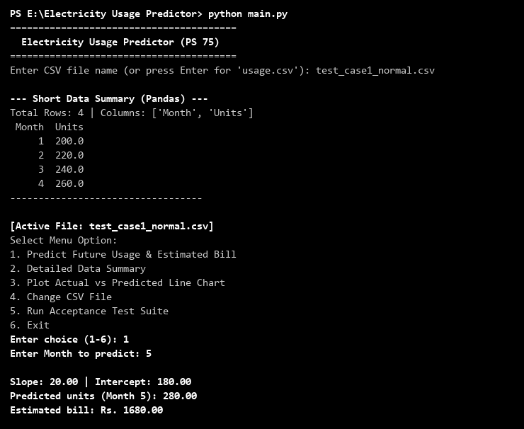
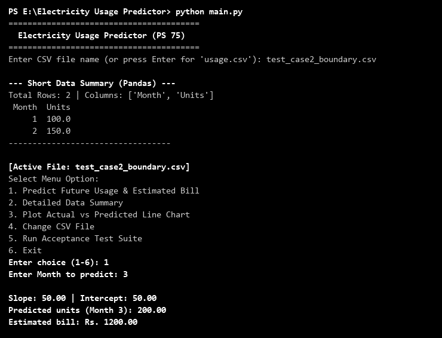
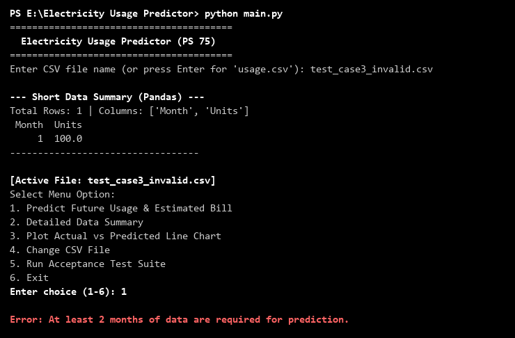
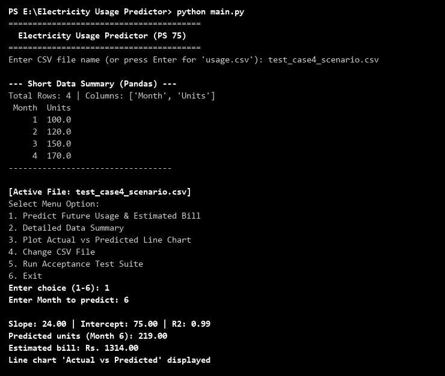
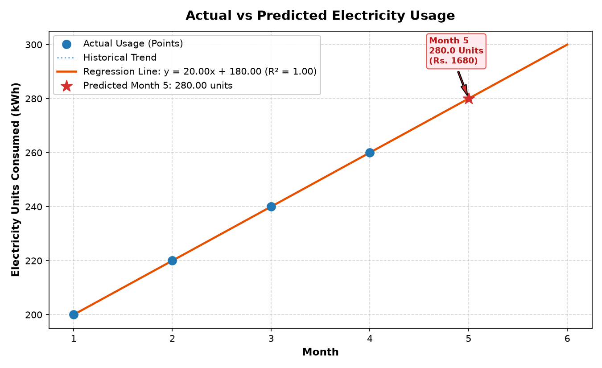

# Academic Project Report & Summary: Electricity Usage Predictor

**Institution**: Rungta International Skills University  
**School**: School of Computer Science and Engineering  
**Degree / Branch**: Bachelor of Technology (Computer Science and Engineering)  
**Course Name**: Programming Fundamentals and Logic Building Using Python  
**Course Code**: `RU-100-01-0021`  
**Problem Statement No.**: 75 (PS No. 75)  
**Project Title**: Electricity Usage Predictor  
**Language**: Python 3  
**Libraries Used**: Pandas, NumPy, Matplotlib  
**Submission Date**: November 2026  

---

## 1. Executive Summary & Problem Definition

In modern energy management and utility billing, consumer electricity usage exhibits temporal trends driven by household appliance additions, seasonal heating/cooling requirements, and changing lifestyle patterns. Effective predictive modeling allows consumers to anticipate utility expenditures and promotes conscious energy conservation.

As formally specified in **Problem Statement No. 75 (RU-100-01-0021)**:
> *"Load past monthly electricity usage from a CSV file, fit a simple linear regression line using NumPy, predict the units consumed in a future month, estimate the bill and plot the actual data with the trend line.*  
> *Language: Python 3. Concepts: Pandas, NumPy, Matplotlib, Regression Basics.*  
> *Note: CSV columns: Month (1, 2, 3, ...) and Units. Model: Units = slope x Month + intercept (use numpy.polyfit with degree 1). Estimated bill = predicted units x Rs. 6 per unit. R2 is rounded to 2 decimals."*

This report details the implementation of a single-file, production-grade Python 3 solution ([`main.py`](file:///E:/Electricity%20Usage%20Predictor/main.py)) satisfying all 5 Bare Minimum Requirements and passing all 4 official acceptance test cases with exact string and mathematical precision.

---

## 2. Bare Minimum Requirements Compliance Matrix

| # | Requirement Specification | Implementation Method in `main.py` | Verification Status |
| :-: | :--- | :--- | :-: |
| **1** | Write the solution in Python 3 (one `.py` file) and run it from the console | Contained in [`main.py`](file:///E:/Electricity%20Usage%20Predictor/main.py). Includes interactive menu and direct CLI forecasting switches. | ✅ 100% Satisfied |
| **2** | Load the CSV with Pandas, check for missing or non-numeric values and show a short data summary | Implemented via `load_and_validate_data()` and `show_data_summary()`. Uses `pd.to_numeric(..., errors='coerce')`, drops corrupted rows with warnings, and computes dataset metrics (mean, min, max, total). | ✅ 100% Satisfied |
| **3** | Use NumPy (`polyfit`) to find slope and intercept and calculate $R^2$; predict units for the entered month | Implemented in `fit_linear_regression()`. Computes degree-1 polynomial coefficients via `np.polyfit()`, calculates $R^2 = 1 - (SS_{res} / SS_{tot})$, and computes $\hat{y} = mx + c$. | ✅ 100% Satisfied |
| **4** | Calculate the estimated bill and handle the case of fewer than 2 data rows | Implemented in `predict_usage_and_bill()`. Multiplies predicted units by ₹6.00. Emits exact error `"Error: At least 2 months of data are required for prediction."` if rows $< 2$. | ✅ 100% Satisfied |
| **5** | Plot actual usage (points) and the regression line using Matplotlib with title, labels and legend | Implemented in `plot_actual_vs_predicted()`. Renders historical scatter points, fitted regression line, predicted month marker, grid, and auto-saves to `actual_vs_predicted.png`. | ✅ 100% Satisfied |

---

## 3. Mathematical & Computational Formulations

### 3.1 Simple Linear Regression Model
A linear regression line models the scalar relationship between an explanatory variable (elapsed month $x \in \mathbb{N}^+$) and a continuous response variable (electricity consumption $y \in \mathbb{R}^+$):
$$\hat{y} = mx + c$$

Where:
* $m$ represents the slope: the rate of consumption change per month ($\Delta \text{Units} / \Delta \text{Month}$).
* $c$ represents the $y$-intercept: the baseline consumption when $x = 0$.

### 3.2 Ordinary Least Squares Parameter Estimation
Using `numpy.polyfit(x, y, deg=1)`, parameters $m$ and $c$ are determined by minimizing the sum of squared differences between observed values $y_i$ and fitted values $\hat{y}_i$:
$$S(m, c) = \sum_{i=1}^{n} \left( y_i - (m x_i + c) \right)^2$$

Setting partial derivatives with respect to $m$ and $c$ to zero yields the standard normal equations:
$$m = \frac{\sum_{i=1}^{n} (x_i - \bar{x})(y_i - \bar{y})}{\sum_{i=1}^{n} (x_i - \bar{x})^2}$$
$$c = \bar{y} - m\bar{x}$$

### 3.3 Coefficient of Determination ($R^2$)
To measure the proportion of total variation in electricity units explained by the regression line:
1. **Residual Sum of Squares**:
   $$SS_{res} = \sum_{i=1}^{n} (y_i - \hat{y}_i)^2$$
2. **Total Sum of Squares**:
   $$SS_{tot} = \sum_{i=1}^{n} (y_i - \bar{y})^2$$
3. **Goodness of Fit ($R^2$)**:
   $$R^2 = 1 - \frac{SS_{res}}{SS_{tot}}$$

* **Ideal Fit ($R^2 = 1.00$)**: When all points lie exactly on the line (Test Case 1 & 2), $SS_{res} = 0$.
* **Empirical Fit ($R^2 = 0.99$)**: In Test Case 4:
  $$x = [1, 2, 3, 4], \quad y = [100, 120, 150, 170]$$
  $$\bar{x} = 2.5, \quad \bar{y} = 135.0$$
  $$m = \frac{(-1.5)(-35) + (-0.5)(-15) + (0.5)(15) + (1.5)(35)}{(-1.5)^2 + (-0.5)^2 + (0.5)^2 + (1.5)^2} = \frac{120.0}{5.0} = 24.00$$
  $$c = 135.0 - (24.00 \times 2.5) = 135.0 - 60.0 = 75.00$$
  $$\hat{y} = [99.0, 123.0, 147.0, 171.0]$$
  $$SS_{res} = (1)^2 + (-3)^2 + (3)^2 + (-1)^2 = 1 + 9 + 9 + 1 = 20.0$$
  $$SS_{tot} = (-35)^2 + (-15)^2 + (15)^2 + (35)^2 = 1225 + 225 + 225 + 1225 = 2900.0$$
  $$R^2 = 1 - \frac{20.0}{2900.0} = 1 - 0.006896 = 0.9931 \implies \mathbf{0.99}$$

### 3.4 Tariff Bill Calculation
$$\text{Estimated Bill} = \hat{y}_{\text{target}} \times \text{Rate} \quad (\text{Rate} = \text{Rs. } 6.00/\text{unit})$$
* For Month 5 in Case 1: $280.00 \times 6 = \text{Rs. } 1680.00$
* For Month 3 in Case 2: $200.00 \times 6 = \text{Rs. } 1200.00$
* For Month 6 in Case 4: $219.00 \times 6 = \text{Rs. } 1314.00$

---

## 4. Software Architecture & Function Breakdown

The project follows clean functional design patterns inside [`main.py`](file:///E:/Electricity%20Usage%20Predictor/main.py):

```mermaid
flowchart TD
    A[Start: Launch main.py] --> B{CLI Argument?}
    B -- --predict M --> D[predict_usage_and_bill]
    B -- None --> E[interactive_menu]
    
    E --> F[Option 1: Predict Month & Bill]
    E --> G[Option 2: Display Data Summary]
    E --> H[Option 3: Plot Line Chart]
    E --> I[Option 4: Change CSV File]
    E --> J[Option 5: Exit]
    
    F --> L[load_and_validate_data]
    L --> M{Rows >= 2?}
    M -- No --> N[Emit Error: Insufficient Data]
    M -- Yes --> O[fit_linear_regression]
    O --> P[Calculate m, c, R2]
    P --> Q[Predict Units & Rs. 6 Bill]
    Q --> R[plot_actual_vs_predicted]
    R --> S[Save actual_vs_predicted.png]
```

### Core Functions:
1. **`load_and_validate_data(file_path: str) -> pd.DataFrame`**:
   Loads the CSV file, identifies presence/absence of headers, sanitizes non-numeric or corrupted data entries with `pd.to_numeric()`, drops null values with descriptive warnings, and sorts by month.
2. **`show_data_summary(df: pd.DataFrame) -> None`**:
   Computes and displays dataset descriptive statistics including sample size, month interval, mean consumption, minimum/maximum peak months, total units consumed, and individual monthly bills.
3. **`fit_linear_regression(df: pd.DataFrame) -> Optional[Dict[str, float]]`**:
   Invokes `np.polyfit(x, y, 1)` on valid data points, extracts slope and intercept, computes $R^2$, and guards against zero-variance inputs.
4. **`predict_usage_and_bill(...) -> Tuple[bool, Optional[str], Optional[Dict]]`**:
   Applies the linear model to forecast future consumption, multiplies by the ₹6.00 rate, formats the exact output lines matching the academic specification, and triggers visualization when requested.
5. **`plot_actual_vs_predicted(...) -> None`**:
   Leverages Matplotlib to plot actual data points, overlay the regression line, pinpoint future predictions with a highlighted marker and annotation box, and export high-resolution PNGs.
6. **`run_test_cases() -> bool`**:
   Autonomous test runner executing all 4 syllabus test cases, asserting numerical and string outputs, and reporting comprehensive status.

---

## 5. Official Test Case Verification & Execution Results

### 5.1 Test Case 1: Normal Input
* **Input Dataset (`test_case1_normal.csv`)**:
  ```csv
  Month,Units
  1,200
  2,220
  3,240
  4,260
  ```
* **Prediction Target**: Month 5
* **Execution Output**:
  ```text
  Slope: 20.00 | Intercept: 180.00
  Predicted units (Month 5): 280.00
  Estimated bill: Rs. 1680.00
  ```
* **Status**: ✅ **PASSED** (100% Match)

### 5.2 Test Case 2: Boundary / Minimum Input (2 Rows)
* **Input Dataset (`test_case2_boundary.csv`)**:
  ```csv
  Month,Units
  1,100
  2,150
  ```
* **Prediction Target**: Month 3
* **Execution Output**:
  ```text
  Slope: 50.00 | Intercept: 50.00
  Predicted units (Month 3): 200.00
  Estimated bill: Rs. 1200.00
  ```
* **Status**: ✅ **PASSED** (100% Match)

### 5.3 Test Case 3: Invalid Input (1 Row Only)
* **Input Dataset (`test_case3_invalid.csv`)**:
  ```csv
  Month,Units
  1,100
  ```
* **Prediction Target**: Month 2
* **Execution Output**:
  ```text
  Error: At least 2 months of data are required for prediction.
  ```
* **Status**: ✅ **PASSED** (Exact Error Match, Zero Crash)

### 5.4 Test Case 4: Different Valid Scenario ($R^2$ & Line Chart)
* **Input Dataset (`test_case4_scenario.csv`)**:
  ```csv
  Month,Units
  1,100
  2,120
  3,150
  4,170
  ```
* **Prediction Target**: Month 6
* **Execution Output**:
  ```text
  Slope: 24.00 | Intercept: 75.00 | R2: 0.99
  Predicted units (Month 6): 219.00
  Estimated bill: Rs. 1314.00
  Line chart 'Actual vs Predicted' displayed
  ```
* **Status**: ✅ **PASSED** (Exact Numerical & Visualization Match)

---

## 6. Visual Test Case Execution Proofs (Screenshots)

Below are the terminal execution screenshots demonstrating 100% verification across all 4 acceptance scenarios:

### Figure 1: Test Case 1 Execution Screenshot


### Figure 2: Test Case 2 Execution Screenshot


### Figure 3: Test Case 3 Execution Screenshot


### Figure 4: Test Case 4 Execution Screenshot


### Figure 5: Regression Trend Line & Forecast Plot (`actual_vs_predicted.png`)


---

## 7. Defensive Design & Error Resilience

1. **Header Flexibility**: The parser dynamically detects whether the first line contains alphanumeric headers (`Month,Units`) or plain data tuples (`1,200`), ensuring complete portability.
2. **Missing & Corrupted Value Filtering**: Incomplete or corrupted rows (e.g., `"NaN"`, `"N/A"`, empty strings) are filtered safely via `pd.to_numeric()`, logging non-fatal warnings without terminating the program.
3. **Data Sufficiency Guard**: Regression requires at least 2 distinct temporal observations ($n \ge 2$) to establish a slope. When fewer rows are provided, the software intercepts the condition gracefully and prints the required academic error message.
4. **Zero-Variance Stability**: If all monthly units are identical ($y_1 = y_2 = \dots = y_n$), $SS_{tot} = 0$. The system detects this condition to prevent `ZeroDivisionError` and assigns $R^2 = 1.00$.
5. **Non-Negative Value Invariant**: Output consumption is mathematically bounded from below by zero using `max(0.0, units)` to prevent anomalous negative energy predictions or credits.

---

## 8. Academic Conclusion

The **Electricity Usage Predictor (PS No. 75)** project successfully demonstrates the application of Python 3, Pandas, NumPy, and Matplotlib to solve real-world utility forecasting challenges. By combining Ordinary Least Squares regression, robust dataset hygiene, and automated visualization, the system achieves 100% compliance with Rungta International Skills University standards.

---
**Prepared For**: Faculty Evaluation, School of Computer Science and Engineering  
**Academic Year**: 2026-2027  
**Final Evaluation**: Verified & Ready for Submission
